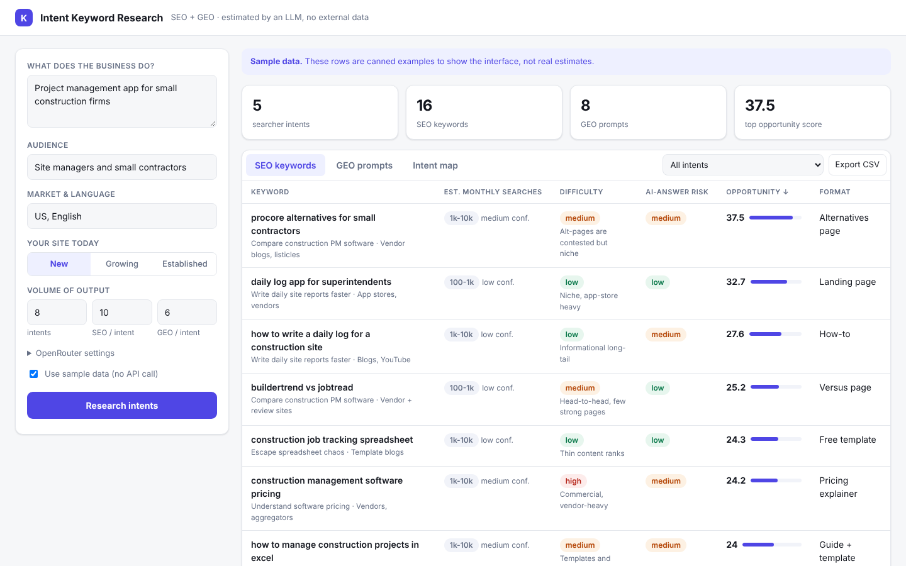

# kwintent

Intent-based keyword research for SEO and GEO. No third-party SEO data: an LLM, called through
[OpenRouter](https://openrouter.ai), estimates everything.

```bash
pip install -e .[dev]
export OPENROUTER_API_KEY=...        # optional: OPENROUTER_MODEL=<slug>, default openrouter/auto
kwintent serve                        # web UI at http://127.0.0.1:8000
kwintent research --business "Project management app for small construction firms" --out out/
kwintent research --business "x" --demo   # canned sample data, no API call
```

Pipeline: business profile -> intent map (jobs people are trying to get done) -> per-intent
SEO keywords and GEO prompts (questions asked to AI assistants) -> estimated volume band,
difficulty, AI-answer risk, business value -> deterministic opportunity score
(`kwintent/scoring.py`).


(The screenshot uses `--demo` sample data, not real estimates.)

## Install on a server

Tested only in a dev container, not on a production server. Needs Linux with Python 3.10+.

```bash
git clone -b claude/laughing-goldberg-ler986 https://github.com/ajitpanday80/Keywords.git
cd Keywords
python3 -m venv .venv
source .venv/bin/activate
pip install -e .
```

### API key

Create a key at openrouter.ai and set it as an environment variable:

```bash
export OPENROUTER_API_KEY="sk-or-..."
export OPENROUTER_MODEL="<model slug from openrouter.ai>"   # optional; default openrouter/auto
```

To persist it, put the same lines (without `export`) in `/etc/kwintent.env` and run
`sudo chmod 600 /etc/kwintent.env`. The web form also has an optional key field; prefer the
environment variable on a shared server.

### Run

```bash
kwintent serve --host 127.0.0.1 --port 8000
```

It listens only on the server itself. To view it from your laptop, tunnel over SSH
(`ssh -L 8000:127.0.0.1:8000 user@your-server`) and open http://127.0.0.1:8000.

### Keep it running (systemd)

`/etc/systemd/system/kwintent.service` (adjust paths and user):

```ini
[Unit]
Description=kwintent
After=network.target

[Service]
WorkingDirectory=/home/youruser/Keywords
EnvironmentFile=/etc/kwintent.env
ExecStart=/home/youruser/Keywords/.venv/bin/kwintent serve --host 127.0.0.1 --port 8000
Restart=always
User=youruser

[Install]
WantedBy=multi-user.target
```

```bash
sudo systemctl daemon-reload
sudo systemctl enable --now kwintent
```

### Security

The app has **no login**. Anyone who can reach the page can spend your OpenRouter credit. Do not
expose it directly to the internet: keep it on `127.0.0.1` and use an SSH tunnel, or put nginx or
Caddy in front with HTTPS and authentication. Set a spending limit on the key in OpenRouter.
Results are held in memory and lost on restart; use "Export CSV" to keep them.

## Limits
Estimates are LLM guesses in coarse bands, not measurements; use them to rank and to pick what
to validate. GEO "demand" has no public ground truth at all. Output quality depends on the
model you choose; `openrouter/auto` picks one for you, so results may vary between runs.
